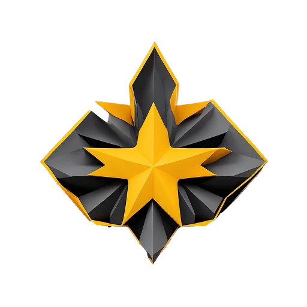
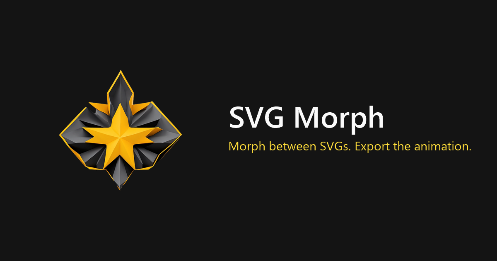
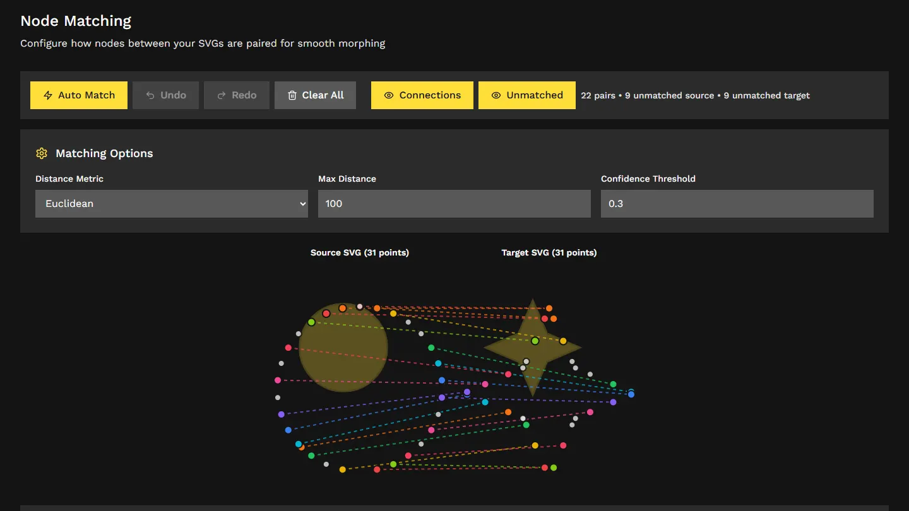
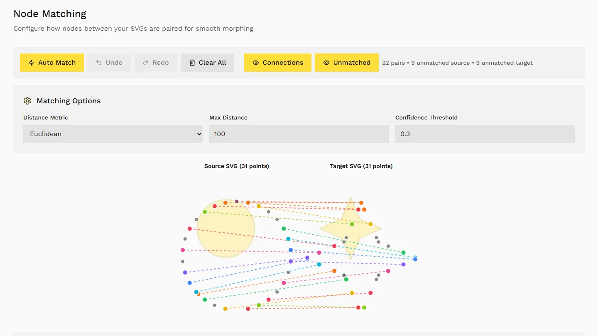
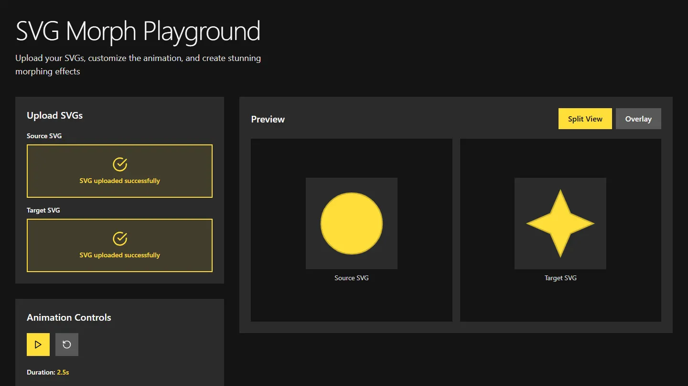
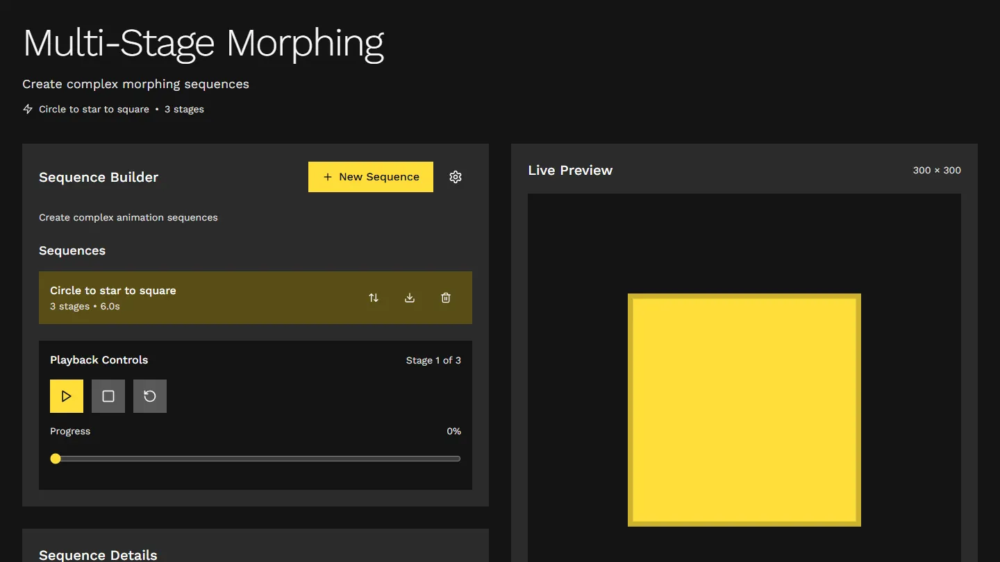
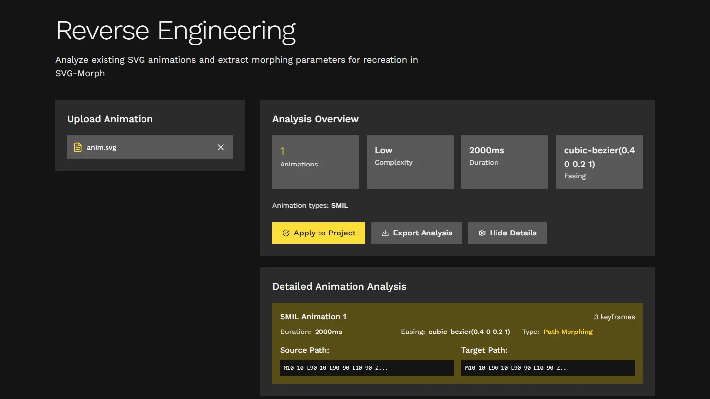

<p align="center">
  <a href="https://juliancallejas.github.io/SVG-Morph/">
    
  </a>
</p>

<h1 align="center">SVG Morph</h1>

<p align="center">
  Morph one SVG into another and export the animation.<br/>
  Everything runs in your browser: no account, no backend, no upload.
</p>

<p align="center">
  <a href="https://juliancallejas.github.io/SVG-Morph/"><strong>Open the app</strong></a>
</p>

<br/>

<p align="center">
  
</p>

SVG Morph turns two SVG files into a smooth morphing animation. It normalizes both paths so they have the same number and order of commands, pairs their nodes, interpolates between them and lets you export the result as code, 3D models or video. It is part of the app family by { jc-develop }.

---

## How to use it

### 1. Load two SVGs

Open the **Studio** and, in **Upload & Preview**, add a source and a target SVG. You can:

- drop or pick `.svg` files from your computer,
- import an SVG from a URL,
- or search an icon library (Phosphor, Tabler and more through Iconify) and use an icon as source or target.

Imported SVGs are sanitized with DOMPurify before they are used.

### 2. Match the nodes

In **Node Matching**, press **Auto Match** to pair the points of both shapes. Each colored line is one pair. Adjust the distance metric, the maximum distance and the confidence threshold if the pairing looks off, and use **Undo**, **Redo** and **Clear All** to fix it by hand. Good pairing is what makes a morph look natural.

| Dark theme | Light theme |
| --- | --- |
|  |  |

### 3. Tune the animation

In **Animation**, preview the morph in real time and adjust duration, easing and playback until it feels right.

### 4. Export

In **Export**, pick the format that fits where the animation will live:

| Group | Formats |
| --- | --- |
| Code | SVG with SMIL, CSS keyframes, JavaScript (vanilla, GSAP or Anime.js), React component |
| 3D | STL, OBJ, PLY, GLTF |
| Video | GIF, MP4, WebM |

Choose the animation layer by context: **SMIL** keeps running when the SVG is used inside an `` tag or a CSS background, while **CSS keyframes** are better when the SVG is inline and should stay in sync with the page. The exported formats are described in [EXPORT-SVG.md](EXPORT-SVG.md).

### Other tools

| Tool | What it does |
| --- | --- |
| **Playground** | The quickest path: upload two SVGs, preview, export. |
| **Studio** | The full workflow above, including React components and a 3D preview. |
| **Multi-stage** | Chain more than two SVGs into a single sequence. |
| **3D** | Extrude the shapes and morph them as 3D solids. |
| **Reverse engineering** | Analyze an animated SVG and extract its animation parameters. |

| Playground | Multi-stage | Reverse engineering |
| --- | --- | --- |
|  |  |  |

> Icon libraries are the only feature that calls an external service (the public Iconify API). Your own SVG files never leave the browser.

---

## Built with

| Area | Technology |
| --- | --- |
| App | [React 18](https://react.dev), [TypeScript](https://www.typescriptlang.org) (strict), [Vite 5](https://vitejs.dev) |
| Styling | [Tailwind CSS 3](https://tailwindcss.com), [Framer Motion](https://www.framer.com/motion/), [Lucide](https://lucide.dev) |
| State and routing | [Zustand](https://zustand-demo.pmnd.rs), [React Router 6](https://reactrouter.com) |
| Path math | [svg-path-commander](https://github.com/thednp/svg-path-commander), [d3-interpolate](https://github.com/d3/d3-interpolate) |
| 3D | [three.js](https://threejs.org) |
| Icons | [Iconify](https://iconify.design) (Phosphor and Tabler sets) |
| Safety | [DOMPurify](https://github.com/cure53/DOMPurify) for imported SVGs |
| Tests | [Vitest](https://vitest.dev) |
| Package manager | [pnpm](https://pnpm.io) |

Heavy path processing runs in a Web Worker and keeps a synchronous fallback, so the UI stays responsive on complex shapes.

---

## Run it locally

You need [Node.js](https://nodejs.org) 20 or newer and [pnpm](https://pnpm.io/installation).

```bash
git clone https://github.com/JulianCallejas/SVG-Morph.git
cd SVG-Morph
pnpm install
pnpm dev
```

Vite prints the local address, usually `http://localhost:5173`.

### Scripts

| Command | What it does |
| --- | --- |
| `pnpm dev` | Dev server |
| `pnpm build` | Production build into `dist/` |
| `pnpm preview` | Serve the production build locally |
| `pnpm lint` | ESLint |
| `pnpm test` | Vitest, single run |
| `pnpm test:watch` | Vitest, watch mode |
| `pnpm check:smil <export.svg>` | Loads an exported SMIL SVG in Chrome and Firefox and compares the frames |

The production build uses the `/SVG-Morph/` base path for GitHub Pages. To serve it from the root of another host, set `VITE_BASE=/` before building.

---

## Contributing

Read [AGENTS.md](AGENTS.md) first: it describes the project structure, the code conventions, the rules for SVG and animation work, and the checks to run before a change is done. Commits follow [Conventional Commits](https://www.conventionalcommits.org).

---

#### 🌟 Thank you for stopping by. Every small shape can become something new, so keep morphing your ideas into something great.

<p align="center">
<a href="https://github.com/JulianCallejas">
  
</a>
</p>
